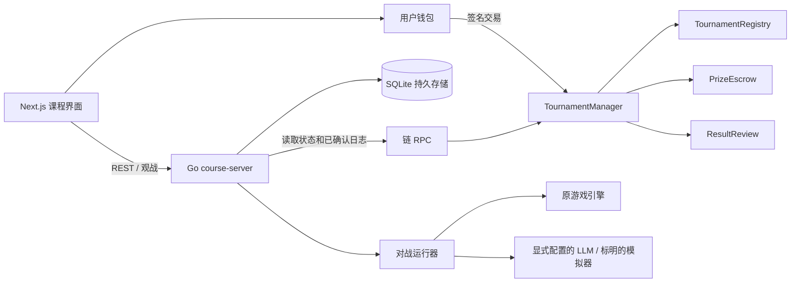
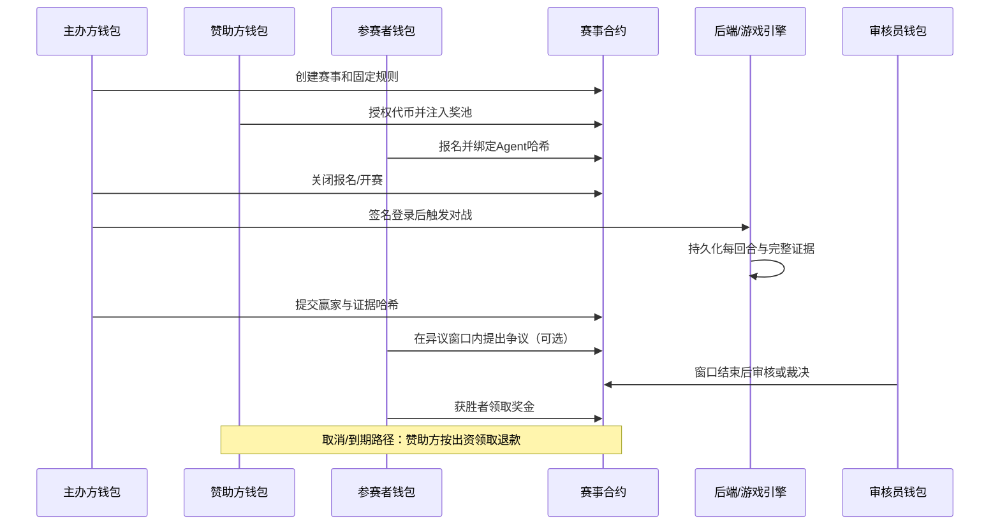
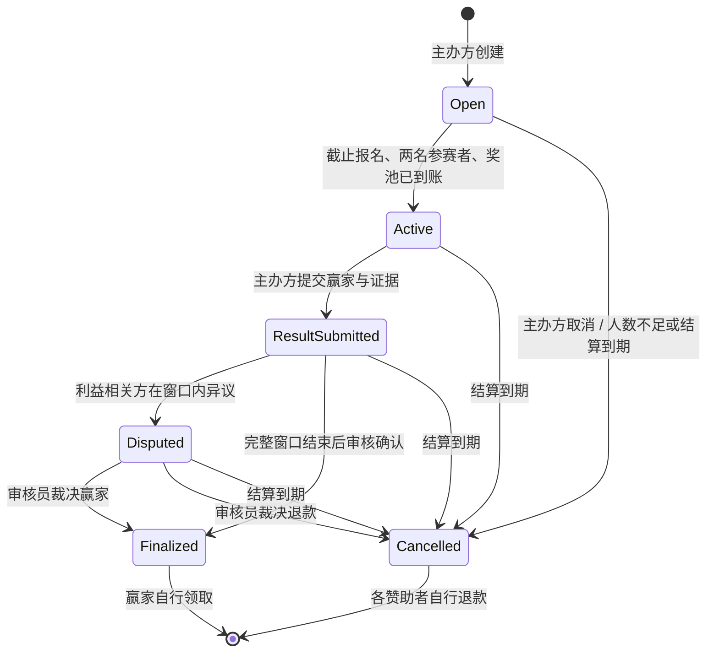
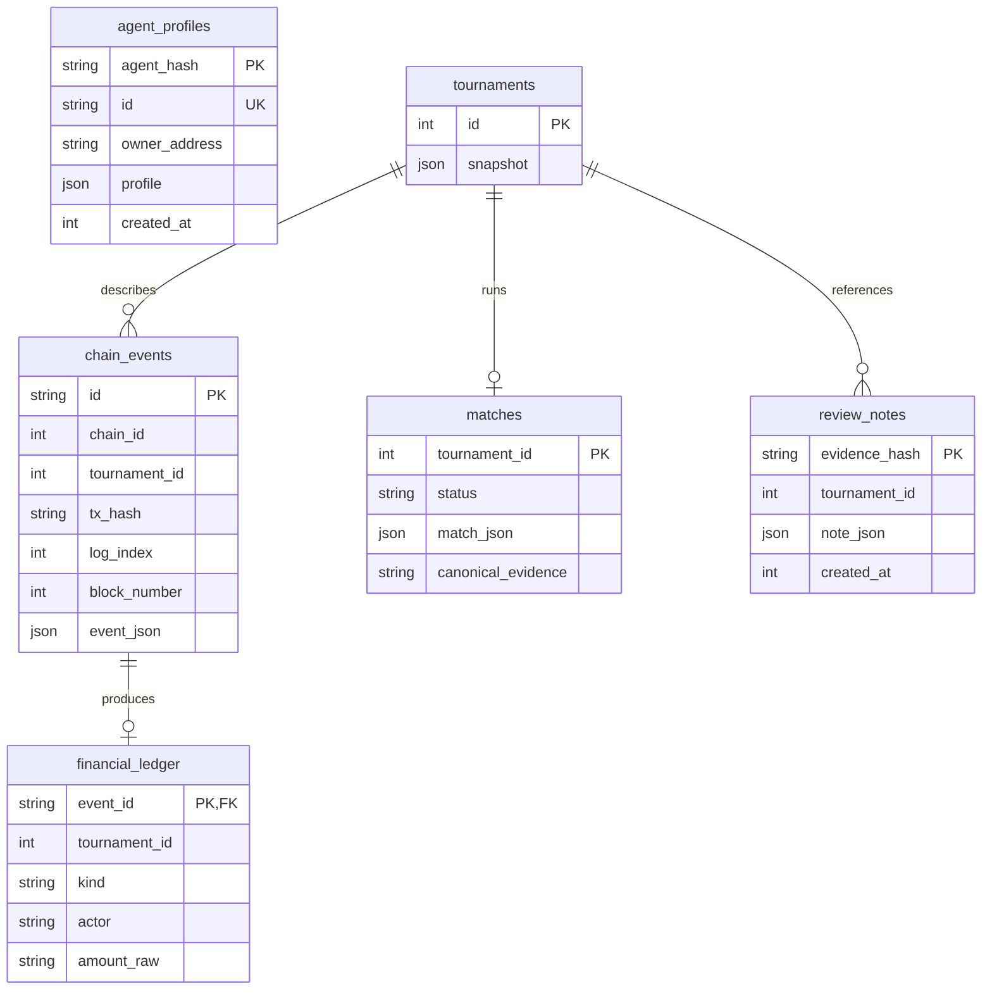
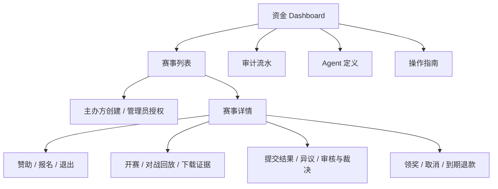

# 课程版架构与设计决策

## 系统边界

合约接口与最终状态枚举见 [CONTRACT.md](CONTRACT.md)。后端响应格式见 [API.md](API.md)。

## ADR-001：以链上状态作为资金真相

**背景：** 黑客松版把内存中的下注/投票与链上资金混在一起，前端回调缺失或服务器重启会造成差异。

**决策：** 钱包直接调用合约，后端读取合约和已确认事件。HTTP 请求不能宣告“已付款”。索引数据库只是可重建的查询视图。

**代价：** 用户承担 Gas 和确认等待；RPC 故障需要清楚呈现。链上数据不能代替链下个人资料、完整对局记录和用户测试。

## ADR-002：新增赛事领域，保留游戏引擎

**背景：** 原后端围绕观众下注、AC 余额和 PVE 押金组织。直接把比赛命名改为赛事，会继承不适用的资金规则。

**决策：** 课程服务入口为 `backend/cmd/course-server`，新领域位于 `backend/internal/tournament`；复用 `engine` 和 `agent`，隔离旧版资金接口。旧代码和历史文档可作为学习对照。

**代价：** 新旧入口须清楚标记，默认启动、部署、前端导航均指向课程版，不能混用旧合约地址。

## ADR-003：赞助奖池与 pull payment

**决策：** 报名免费，两名参赛者决出一个赢家。资金先托管，审核完成后赢家自己领取；取消时每位赞助者自己退款。当前无抽成。

**原因：** 奖金支付、赞助退款、结果争议构成清楚的业务闭环。逐人领取避免批量付款时单个收款失败阻塞全部用户。

**安全要求：** 每个赛事和出资人独立账本、先更新状态再转账、禁止双领、使用 SafeERC20 与重入保护。按实际到账校验代币行为，测试币与真实资产清楚区分。

## ADR-004：独立审核与超时退出

**决策：** 创建时确定审核员及期限，组织者提交完整证据哈希；异议窗口后审核员才可确认或裁决。未在最终期限内完成的赛事允许按规则取消和退款。

**限制：** 哈希证明某份记录在提交之后未变化，不证明记录最初就真实，也不能证明提示词公平。需要公开规则、独立审核和可重放的动作日志。

## ADR-005：不可变 Agent 定义

**决策：** 后端保存钱包拥有的 Agent 名称/提示词定义，计算规范 JSON 的 Keccak-256。报名时把该 hash 写入赛事，运行时据此找到并核验定义，证据内包含定义快照。

**原因：** 避免报名后偷偷换提示词；无需把长提示词永久写链。课程版共用服务端显式配置的模型接口，不保存用户 API Key。

## ADR-006：单实例 SQLite 与持久任务

**决策：** 本轮沿用熟悉的 SQLite，开启合适的并发与持久设置，金额通过十进制整数字符串存储，避免浮点损失。赛事索引、nonce、运行任务、回合记录和证据均落盘。

**边界：** 单实例带持久磁盘足以完成课程演示。水平扩展前应迁移数据库与任务调度；不能仅增加 API 容器副本就宣称可扩展。

## ADR-007：验证证据优先

**决策：** 仓库提供确定性的本地链演示、单元/集成测试、Gas 测量和 CI。模拟链/模拟 LLM 必须标识；公网部署和用户评价另存实际执行证据。

**原因：** “代码存在”“编译通过”“本地流程通过”“公网部署可用”是四种不同结论，报告必须分别记录。

## 主要过程

## 状态机

开始比赛必须在报名截止后，且给结果审核留下完整时间；不能提前关闭报名。指定审核员不能主办、参赛或赞助该赛事。角色在操作时重新校验；若主办方/审核员被撤权或失联，任何人仍可在超时后触发退款。管理员可撤销角色，但不能直接提走奖池。

## 数据模型

除 `financial_ledger.event_id` 的外键外，图中的赛事关系主要是领域逻辑关系。赛事快照、Agent 状态和完整回合保存在版本化 JSON 中；Agent 报名关联由快照中的 `participant_agents` 指向 `agent_hash`。另有 `login_nonces`、`database_identity`、`index_cursors` 和 `index_checkpoints` 支持鉴权与同步。

可从链重建：赛事投影、链事件、金融流水、索引游标。必须备份：Agent 定义、比赛动作/证据、审核理由。链上哈希无法恢复丢失的原始文件。

## 确认、幂等和恢复

索引目标为 `head - confirmations`，每批最多 2,000 个区块。赛事快照和日志固定在同一批末区块，事件唯一键包含 chain ID、交易哈希和 log index。该批事件、账本、快照、下一区块游标及 checkpoint 在一个 SQLite 事务中提交，失败整批回滚。

详情页可读取最新链状态，标识 `confirmed:false`，该查询不覆盖已确认投影；资金 Dashboard 只汇总确认事件。若已保存 checkpoint 的区块哈希变化，暂停索引并令 `/ready` 失败，运营人员检查后从部署区块重建投影。课程版没有宣称支持自动处理任意深度重组。

一份数据库绑定一个 chain ID / Manager / deployment block。换部署必须换数据库；同一部署的备份恢复不能更换身份。对战每回合保存状态，服务重启后未完成任务可由主办方恢复；完成后的证据不可通过“再运行”覆盖。

## 界面与任务入口

需要钱包的按钮同时检查网络、身份和链上状态，钱包提交前估算 Gas，提交后等待回执。索引延迟、待确认交易、用户拒签、合约失败和 RPC 故障有独立反馈；前端显示逻辑不取代合约校验。
