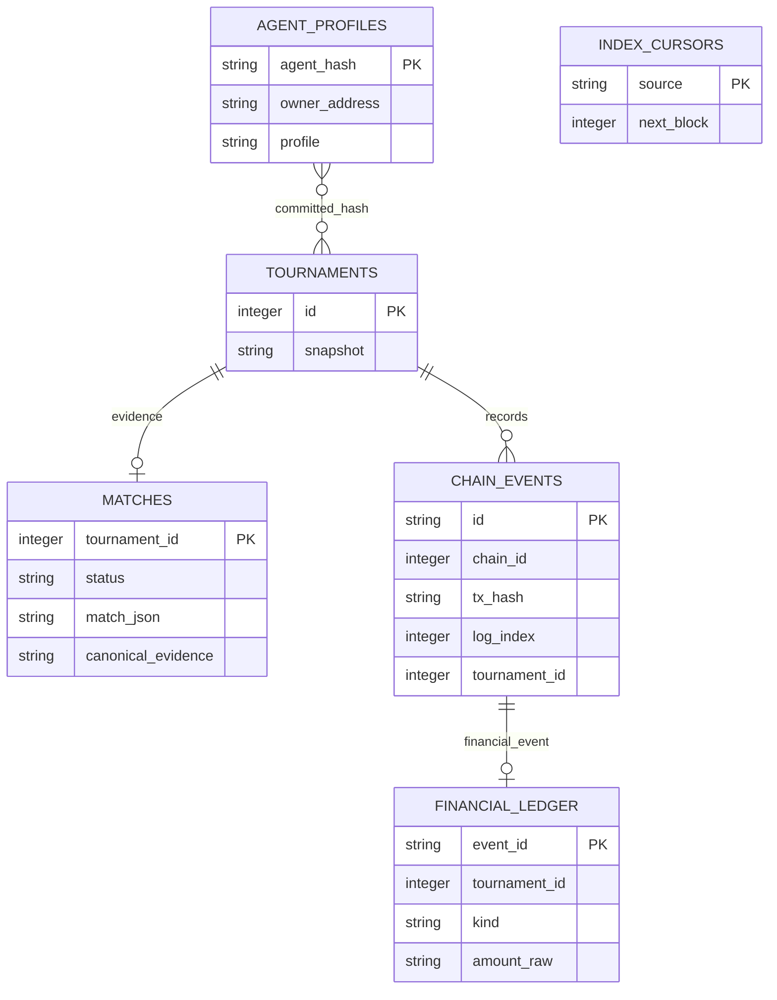

# 报告、评价与演示准备

## 10–15 页技术报告建议结构

| 页数预算 | 内容 | 需要的实际证据 |
| --- | --- | --- |
| 2 页 | 问题、利益相关者、现有流程、资料与访谈 | 引用、匿名反馈、任务场景 |
| 1 页 | 需求、成功指标、区块链适用性 | REQUIREMENTS.md、与中心化替代方案比较 |
| 2 页 | 系统架构、合约交互、数据库模型 | Mermaid 图、代码入口、设计决策 |
| 2 页 | 权限、状态机、资金与安全 | 合约/登录测试、威胁与控制映射 |
| 1 页 | 前后端及钱包体验 | 角色页面、交易状态、异常截图 |
| 2 页 | 测试、Gas、性能、可用性与影响 | 原始测试输出、样本/环境/统计方法 |
| 1 页 | 云部署、运维与恢复 | 公网 URL、合约地址、部署版本、恢复实验 |
| 1 页 | 可行性、伦理与局限、后续工作 | 审核信任、隐私、钱包门槛、真实采用限制 |

共约 12 页；参考文献、封面和附录是否计入页数以课程规则为准。

## 五类设计图

- 系统架构图：见 ARCHITECTURE.md。
- 合约交互图：Manager → Registry / Escrow / Review；补资金输入/输出箭头。
- 数据模型图：见下方 ER 概览，列的最终定义以 `store.go` 为准。
- 流程图：创建、赞助、报名、对战、审核、领奖；取消/争议/超时分支。
- 界面图：Dashboard、赛事详情、审核界面、审计日志、Agent 定义页面。

上图包含业务关联；并非所有边都代表 SQLite 外键。nonce、索引 checkpoint 和数据库部署身份属于基础设施表。

## 十分钟演示脚本

| 时间 | 内容 |
| --- | --- |
| 0:00–1:00 | 用一场赞助赛事解释问题、用户和已固定的规则 |
| 1:00–2:00 | 展示三种权限身份、赛事创建与奖池注资 |
| 2:00–3:00 | 两位开发者选择不可变 Agent 定义并报名 |
| 3:00–4:30 | 开赛、对战及每回合日志，明确真实 LLM 或模拟模式 |
| 4:30–6:00 | 下载证据、哈希核对、主办方提交结果 |
| 6:00–7:00 | 异议窗口结束后独立审核，赢家钱包领奖 |
| 7:00–8:00 | 使用预先准备的第二场赛事展示争议裁决与退款 |
| 8:00–9:00 | 交易流水、事件索引、重启恢复与测试/Gas 结果 |
| 9:00–10:00 | 业务验证、实际限制、个人贡献与下一步 |

本地 Anvil 的时间推进仅用于自动化测试；正式演示应解释这一点。测试网使用真实期限，不把快进录像描述为实际结算速度。

## 用户测试记录模板

每条记录至少包含：匿名参与者编号、角色、使用设备、任务、是否完成、耗时、错误/困惑点、改进建议、测试日期。涉及个人信息时取得同意并最小化保存。

建议任务：找到已落实奖池；赞助；确认自己的报名与 Agent；理解审核/争议期限；领取奖金；取消后找到退款入口。按任务成功率和中位耗时汇总，不用少数样本推断整个市场。

## 交付清单

- [ ] 10–15 页报告以及明确引用。
- [ ] 五类设计图与实际 UI 截图。
- [ ] 可从干净克隆启动的 GitHub 仓库与贡献历史。
- [ ] 公开前端/API URL、网络、代币及四合约地址、部署区块、交易链接。
- [ ] 测试报告、Gas 分析、性能与影响测量。
- [ ] Slides、十分钟视频或现场演示准备。
- [ ] 用户手册。
- [ ] 每名成员的个人贡献说明；如实标出复用工作和本轮新增工作。

以上复选框是提交验收，不随源码实现自动勾选。尤其公网、访谈、视频与贡献不能由代码存在推断完成。
